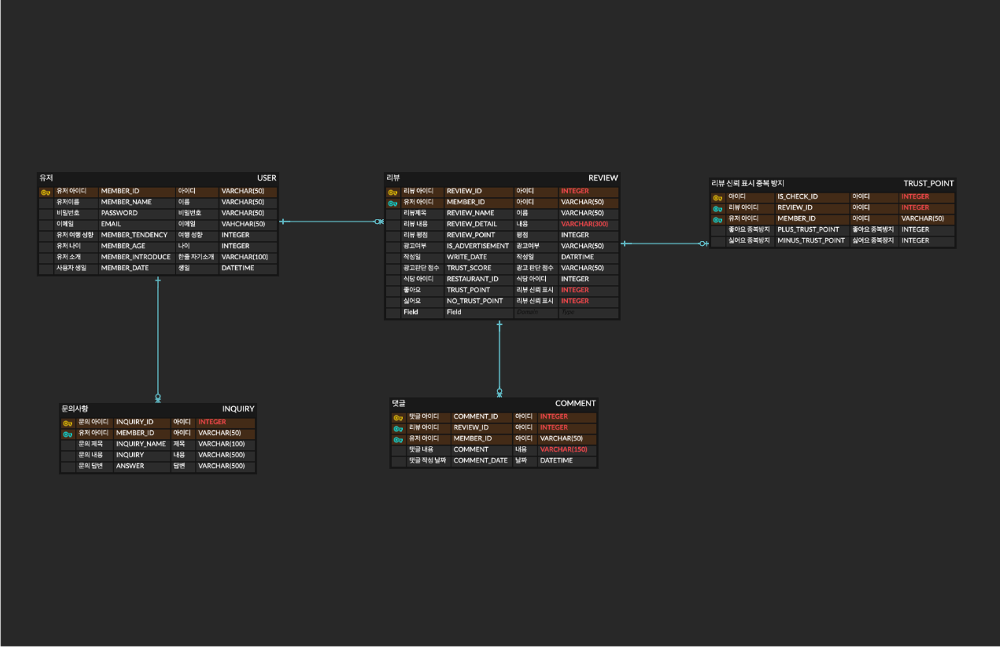
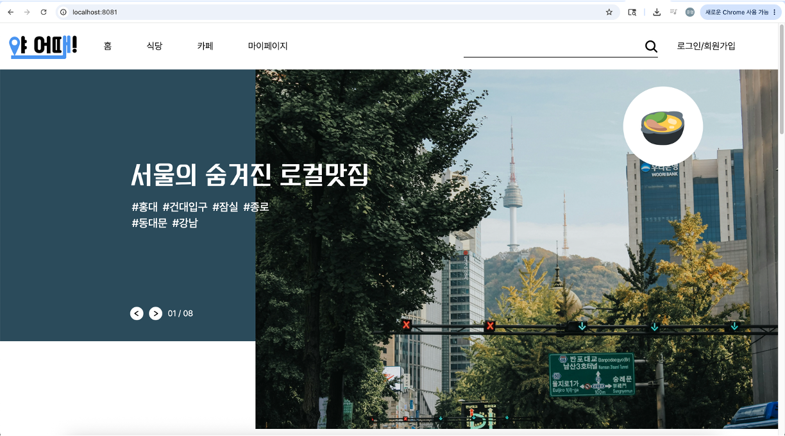
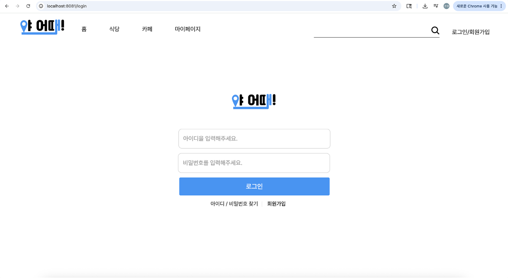
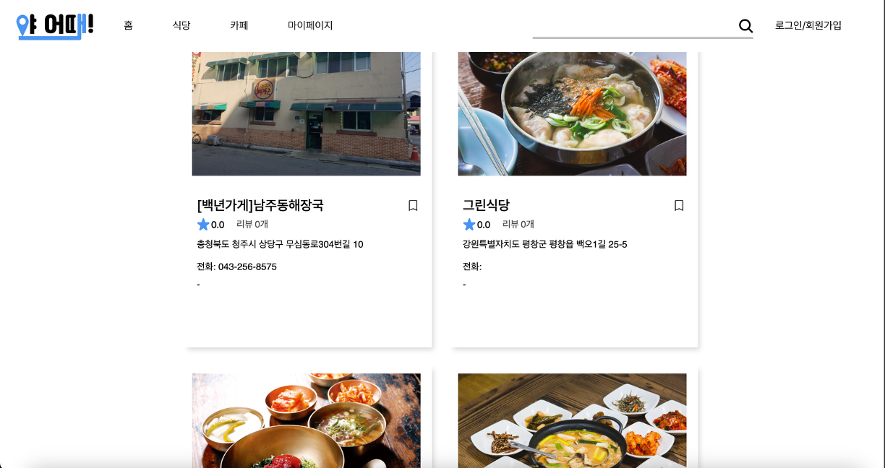
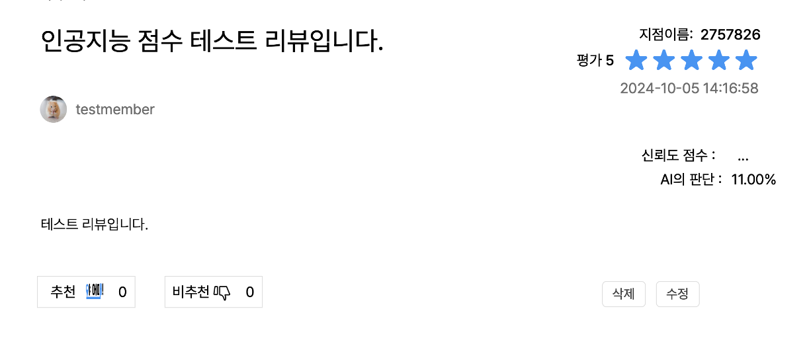
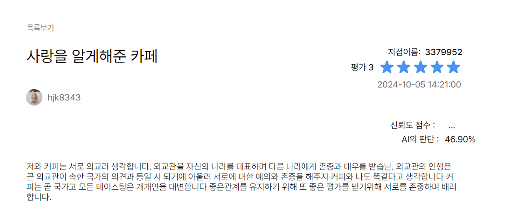
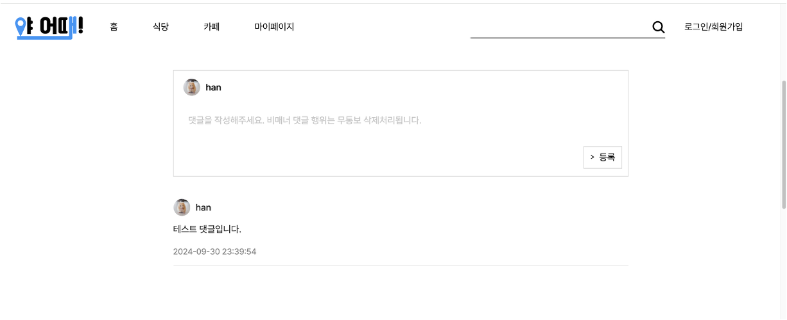

# 야어때

## 사용자 취향과 리뷰 신뢰도를 함께 고려하는 맛집 탐색 서비스

야어때는 광고성·과장성 리뷰로 인해 맛집 정보를 신뢰하기 어렵다는 문제에서 출발한 웹 서비스입니다.

사용자는 공공데이터 기반의 음식점 정보를 지역별로 탐색하고 리뷰를 작성할 수 있습니다. 작성된 리뷰는 외부 AI 분류 모델을 통해 광고 가능성을 분석하며, 다른 사용자의 추천·비추천 결과를 바탕으로 리뷰 신뢰도를 계산합니다. 또한 음식 취향 테스트를 통해 사용자별 성향을 저장하고, 자신의 리뷰와 다른 사용자의 리뷰를 확인할 수 있습니다.

본 저장소는 Java 22와 Spring Boot 기반의 단일 애플리케이션입니다. Spring MVC와 Thymeleaf로 서버와 화면을 함께 구현하고, MySQL에 회원·리뷰·댓글·신뢰도 데이터를 저장합니다.

## 팀 구성 및 역할

| 이름 | 역할 |
|---|---|
| 양준형 | 서비스 기획, 회원·인증·음식점·리뷰·댓글·신뢰도 기능 등 백엔드 개발, Thymeleaf 기반 화면 구현 및 외부 API 연동 |
| 강윤모 | 백엔드 개발 |
| 한승훈 | AI 개발 |
| 한현성 | AI 개발 |
| 송도훈 | 데이터 분석 |
| 피서영 | 디자인 |

---

## 1. 실행 경로 요약

| 실행 경로 | 목적 | 사용 파일/경로 | 접속 주소 |
|---|---|---|---|
| Local Application | 전체 웹 서비스 실행 및 기능 확인 | `gradlew`, `src/main/resources/application.properties` | `http://localhost:8081` |
| Test | Spring 애플리케이션 구동 검증 | `src/test/java` | Gradle 테스트 리포트 |
| External Services | 음식점 조회, 이메일 인증, 리뷰 광고 가능성 분석 | 공공데이터 API, Gmail SMTP, AI 분류 API | 각 서비스 설정에 따름 |

> 기본 실행에는 MySQL과 공공데이터 API 설정이 필요합니다. 회원가입의 이메일 인증에는 Gmail SMTP가, 리뷰 작성·수정 시 광고 가능성 분석에는 외부 AI 분류 서비스가 필요합니다.

---

## 2. 주요 기능

| 구분 | 구현 내용 |
|---|---|
| 회원 관리 | 회원가입, 아이디 중복 확인, 이메일 인증, 로그인·로그아웃, 아이디 찾기, 비밀번호 변경 |
| 세션 인증 | 로그인 세션을 생성하고 리뷰 작성·마이페이지·성향 테스트 등 인증이 필요한 경로를 인터셉터로 보호 |
| 음식점 탐색 | 공공데이터 API에서 음식점 정보를 가져와 전체·지역별 목록, 검색 결과와 상세 정보 제공 |
| 음식 취향 테스트 | 5단계 질문의 답변 조합으로 사용자를 8가지 음식 성향 중 하나로 분류하고 회원 정보에 저장 |
| 리뷰 관리 | 음식점별 리뷰 작성·조회·수정·삭제, 별점과 음식점별 평균 평점 제공 |
| AI 리뷰 분석 | 리뷰 내용을 외부 AI 분류 API로 전달하고 광고 가능성을 백분율로 표시 |
| 리뷰 신뢰도 | 사용자별 리뷰 추천·비추천을 1회로 제한하고, 일정 투표 수 이후 베이지안 방식의 신뢰도 점수 계산 |
| 댓글 | 리뷰별 댓글 등록·조회·삭제 |
| 마이페이지 | 회원 정보, 자기소개와 이름 변경, 본인 리뷰 및 다른 회원의 리뷰 조회 |

---

## 3. 전체 아키텍처

```text
Web Browser
  |
  | HTTP / Session
  v
Spring Boot + Spring MVC :8081
  |
  +--> Thymeleaf Templates / CSS
  |
  +--> Member / Tendency / Restaurant / Review / Comment
  |         |
  |         +--------------------------> MySQL
  |
  +--> Restaurant Search --------------> 공공데이터 음식점 API
  |
  +--> Email Verification -------------> Gmail SMTP
  |
+--> Review Classification ----------> External AI API
```

컨트롤러는 요청 처리와 화면 이동을 담당하고, 서비스는 음식점 API 호출·리뷰 분석·신뢰도 계산·성향 판별을 수행합니다. JPA 기반 저장소는 회원, 리뷰, 댓글과 추천·비추천 이력을 MySQL에 저장하며 Thymeleaf가 서버에서 전달받은 데이터를 화면에 렌더링합니다.

---

## 4. 도메인 구성

| 도메인 | 역할 | 주요 구성 |
|---|---|---|
| `member` | 회원 정보와 음식 성향 관리 | 회원 기본 정보, 약관 동의, 자기소개, 성향 결과 |
| `restaurant` | 음식점 정보 조회 | 지역·검색·상세 조회, 이미지·주소·좌표·영업 정보 |
| `review` | 음식점 리뷰 관리 | 제목, 내용, 별점, AI 판단 결과, 신뢰도 점수 |
| `comment` | 리뷰 의견 관리 | 리뷰별 댓글 작성·조회·삭제 |
| `trustpoint` | 리뷰 평가 이력 관리 | 사용자별 추천·비추천 중복 방지 |
| `AiModel` | 외부 AI 응답 매핑 | 리뷰 광고 가능성 분석 결과 |
| `inquiry` | 문의 데이터 모델 | 사용자 문의 정보 |

### 4.1 ERD

회원은 리뷰와 문의를 작성하고, 리뷰에는 댓글과 사용자별 신뢰도 평가 이력이 연결됩니다. `TRUST_POINT`는 회원과 리뷰의 조합별 추천·비추천 여부를 관리해 중복 평가를 방지합니다.



### 4.2 음식 성향

성향 테스트 결과는 다음 8가지 유형 중 하나로 저장됩니다.

| 유형 | 표시 이름 |
|---|---|
| `SOFT_TOFU_KIMCHI` | 부드러운 두부김치 |
| `PATIENCEFUL_SPICY_TTEOKBOKKI` | 인내심 깊은 매운 떡볶이 |
| `PASSIONATE_BULDAK` | 불닭 열정가 |
| `CAREFUL_CHEONGYANG_PEPPER` | 신중한 청양고추 |
| `MILD_BRAISED_RIBS` | 순한 갈비찜 |
| `COLD_MALATANG` | 차가운 마라탕 |
| `SPICY_EGGPLANT` | 매운 가지 |
| `BULGOGI_OF_PASSION` | 정열의 불고기 |

테스트를 완료하지 않은 회원은 `NOTEST` 상태로 관리됩니다.

### 4.3 리뷰 신뢰도

- 회원은 하나의 리뷰에 추천과 비추천을 각각 한 번만 남길 수 있습니다.
- 추천·비추천 참여자가 20명 이하일 때는 신뢰도 점수를 집계 중 상태로 표시합니다.
- 기준 인원을 넘으면 개별 리뷰의 추천 비율과 전체 리뷰의 평균 추천 수를 이용해 베이지안 방식으로 점수를 계산합니다.
- AI 판단 결과와 사용자 평가를 함께 표시해 한 가지 지표만으로 리뷰를 판단하지 않도록 구성했습니다.

---

## 5. 기술 스택

| 영역 | 기술 |
|---|---|
| Language | Java 22 |
| Framework | Spring Boot 3.3.3, Spring MVC |
| View | Thymeleaf, HTML5, CSS3 |
| Persistence | Spring Data JPA, Hibernate |
| Database | MySQL 8 |
| Session / Validation | HttpSession, Spring MVC Interceptor, Jakarta Validation |
| External API | 공공데이터 음식점 API, Gmail SMTP, AI 리뷰 분류 API |
| HTTP Client | Java `HttpURLConnection`, Spring WebClient |
| Build / Test | Gradle Wrapper, JUnit Platform |
| Utilities | Lombok, Jackson |

---

## 6. 주요 화면

### 6.1 메인 화면

서비스의 주요 메뉴와 추천 콘텐츠를 확인하고 음식점 탐색으로 이동합니다.



### 6.2 로그인

아이디와 비밀번호로 로그인하며 회원가입, 아이디 찾기와 비밀번호 변경 흐름으로 연결됩니다.



### 6.3 음식점 선택

공공데이터 API에서 불러온 음식점의 이미지, 주소, 전화번호, 평균 평점과 리뷰 수를 목록으로 제공합니다.



### 6.4 AI 리뷰 분석 — 짧은 리뷰

리뷰 작성 시 AI 분류 모델의 판단 결과를 백분율로 저장하고, 추천·비추천을 통한 사용자 신뢰도 평가를 함께 제공합니다.



### 6.5 AI 리뷰 분석 — 장문 리뷰

장문의 리뷰도 동일한 분석 흐름으로 처리하여 광고 가능성과 사용자 평가를 함께 확인할 수 있습니다.



### 6.6 댓글

로그인한 사용자는 리뷰에 댓글을 등록하고 리뷰에 대한 의견을 주고받을 수 있습니다.



---

## 7. 디렉터리 구조

```text
.
├── docs/images                         # README 화면 이미지
├── src
│   ├── main
│   │   ├── java/com/fit/Ya_eottae
│   │   │   ├── domain                  # 회원, 음식점, 리뷰, 댓글, 신뢰도 모델
│   │   │   ├── repository              # JPA 기반 데이터 접근 계층
│   │   │   ├── web
│   │   │   │   ├── login               # 로그인·계정 찾기·비밀번호 변경
│   │   │   │   ├── mail                # 이메일 인증
│   │   │   │   ├── main                # 메인·검색·안내 화면
│   │   │   │   ├── member              # 회원가입
│   │   │   │   ├── membertendencytest  # 음식 성향 테스트
│   │   │   │   ├── mypage              # 회원 정보와 리뷰 조회
│   │   │   │   ├── restaurant          # 음식점 API 조회
│   │   │   │   └── review              # 리뷰·댓글·AI 분석·신뢰도
│   │   │   ├── WebConfig.java          # 로그인·비밀번호 변경 인터셉터
│   │   │   └── YaEottaeApplication.java
│   │   └── resources
│   │       ├── static                   # CSS, 이미지, 폰트
│   │       └── templates                # Thymeleaf 화면
│   └── test                             # 애플리케이션 테스트
├── build.gradle
└── gradlew
```

---

## 8. 주요 화면 흐름

```text
메인
  |
  +--> 회원가입 --> 이메일 인증 --> 로그인
  |
  +--> 음식점 목록 --> 지역·이름 검색 --> 음식점 상세
  |                                      |
  |                                      +--> 리뷰 작성 --> AI 광고 가능성 분석
  |                                      |                  |
  |                                      |                  +--> 추천·비추천 / 신뢰도
  |                                      |
  |                                      +--> 댓글 작성·삭제
  |
  +--> 음식 성향 테스트 --> 결과 저장
  |
  +--> 마이페이지 --> 회원 정보 변경 / 작성 리뷰 조회
```

로그인하지 않은 사용자도 음식점과 공개 리뷰를 조회할 수 있습니다. 리뷰 작성·수정, 추천·비추천, 댓글, 성향 테스트와 마이페이지는 로그인 세션을 기준으로 접근을 제한합니다.

---

## 9. 테스트 및 빌드

테스트:

```bash
./gradlew test
```

빌드:

```bash
./gradlew clean build
```

테스트 결과는 `build/reports/tests/test/index.html`에서 확인할 수 있습니다.

---

## 10. 프로젝트 의의

야어때는 맛집 리뷰의 양보다 **정보를 믿을 수 있는가**에 초점을 맞춘 프로젝트입니다. 서비스 문제 정의와 사용자 흐름을 직접 기획하고, 공공데이터 음식점 정보·AI 리뷰 분석·사용자 신뢰도 평가를 하나의 서비스 흐름으로 연결했습니다.

Spring MVC와 Thymeleaf로 화면부터 서버 로직까지 구현하면서 세션 인증, 입력값 검증, JPA 연관관계, 외부 API 연동과 리뷰 평가 로직을 함께 다뤘습니다. 특히 AI의 판단 결과만 제시하지 않고 사용자 추천·비추천 기반 신뢰도를 함께 제공하여 서로 다른 판단 근거를 비교할 수 있도록 설계했습니다.

---

## 11. 기획 확장 방향

초기 기획에서는 다음 기능까지 서비스 확장 대상으로 정의했습니다.

- 취향이 비슷한 사용자의 리뷰를 활용한 개인화 추천
- 추천 음식점과 사용자 성향이 일치하는 이유 제공
- 신뢰 사용자를 팔로우하고 리뷰를 구독하는 기능
- 리뷰 참여 보상과 음식점 도전 이벤트
- 광고성 리뷰의 지속적인 재분류와 운영 정책

현재 README의 주요 기능에는 저장소에서 실제 구현을 확인한 범위만 기재했으며, 위 항목은 향후 개발 방향으로 구분했습니다.
